# NativeProof

NativeProof is a research workspace for testing how a campaign may be received in another market before it launches. It grounds each step in cultural affinity data from Qloo, rehearses campaign versions with labeled synthetic audiences, adapts the copy for the market, compares versions with a deterministic scoring rule, and assembles a report in which every claim points to its source.

NativeProof is decision support, not a forecast. Synthetic participants are AI personas, not people. Every record says whether it is source data, a calculation, a model interpretation, synthetic output, or an unverified hypothesis, so a reader can tell observed signals from generated text.

## Live deployment

| | |
|---|---|
| Web app | https://nativeproof.vercel.app |
| API | https://nativeproof-api.onrender.com ([`/health`](https://nativeproof-api.onrender.com/health), [`/ready`](https://nativeproof-api.onrender.com/ready)) |
| Judging account | Email `nativeproof-judge@example.com`, password `NativeProof-Judge-2026` |

The judging account is a shared email-and-password account created for reviewers; it already contains the project recorded in the walkthrough ("Trailhead Coffee · Japan launch"). Google sign-in and an anonymous demo session (labeled fixture data, no provider calls) are also on the sign-in page. The API runs on Render's free plan in Singapore, next to the Supabase project in ap-southeast-2; an UptimeRobot monitor calls `/health` every five minutes to keep it awake, and a cold start, if one happens, takes about a minute.

## Walkthrough video

**[Watch the narrated walkthrough: demo/nativeproof-walkthrough.mp4](demo/nativeproof-walkthrough.mp4)** (9 min 52 s, 33 MB; also attached to the [v1.0.0 release](https://github.com/vishavmehra/NativeProof/releases/tag/v1.0.0)). It is one real session on the deployed app, from sign-in to the final report, using live Qloo data and live models.

**Architecture and workflow diagrams:** all 12 are in [`diagrams/`](diagrams/), as editable draw.io sources (`diagrams/src/`), SVG (`diagrams/svg/`) and PNG (`diagrams/png/`), and each is embedded in the matching section below. Long runs are sped up, and a label on screen shows the real elapsed time and the playback speed. The voiceover is synthetic. The script, the shot list with measured timings, the captions, and the build script are in [`demo/`](demo/).

Measured in that session (production, October 29, 2026):

| Step | Result | Time |
|---|---|---|
| Atlas discovery, per run, while confirming 5 ambiguous terms | 10 signals resolved, brief with 5 observations, 3 opportunities, 2 risks | 30 to 66 s |
| Quick rehearsal | 12 of 12 synthetic reactions, grounded in 10 evidence records | 56 s |
| Population study, 100 participants, new population | 100 of 100 interviews; 71% positive, 12% mixed, 17% neutral | 2 min 20 s |
| Social simulation, 3 rounds, 20% active, feed of 5 | 60 posts; 9, 4 and 8 stance changes | 70 s |
| Participant follow-up / group question (sample of 5) | Answers cite stored memories | 9 s / 24 s |
| Risk Radar with the uploaded creative (vision model) | 5 findings: 0 high, 1 moderate, 4 low | 27 s |
| Voice, 2 variants | 2 adaptations with change rationale and constraint checks | about 15 s |
| Population study on the same population, version 3 | Positive reactions 71% to 66%; no significance claimed | 1 min 49 s |
| Campaign Arena, 2 concepts | 93.8 against 92.5 (within 5 points) | 80 s |
| Cultural DNA profile | 8 evidence-backed items | 29 s |
| Proof report (no model call) | 8 sections with reproducibility details | 13 s |

## Contents

- [The problem](#the-problem)
- [How a study flows](#how-a-study-flows)
- [Reading the results: labels and confidence](#reading-the-results-labels-and-confidence)
- [Features](#features)
- [Architecture](#architecture)
- [AI workflows](#ai-workflows)
- [Qloo integration](#qloo-integration)
- [Model gateway and routing](#model-gateway-and-routing)
- [Data model](#data-model)
- [Authentication](#authentication)
- [Security model](#security-model)
- [Local setup](#local-setup)
- [Environment variables](#environment-variables)
- [Database migrations](#database-migrations)
- [Deployment](#deployment)
- [Tests](#tests)
- [Scope and limitations](#scope-and-limitations)
- [Repository layout](#repository-layout)
- [Acknowledgments](#acknowledgments)

## The problem

A campaign that works in one market can fail in another for reasons a translation does not catch: a reference that means nothing locally, a tone that reads as arrogant, a symbol with a different association. Teams usually learn this after launch, from real customers. Pre-launch options are slow (agency reviews, panels) or opaque: an AI writing tool will rewrite copy with confidence but cannot say what its suggestions rest on.

NativeProof makes the pre-launch work explicit and inspectable:

- Which cultural signals Qloo returns for the concept in the market, and which terms did not resolve.
- How a synthetic audience built from those signals reacts to each campaign version, and where its reactions disagree.
- What an adaptation changed, why, and whether it kept the brand's protected terms.
- How versions compare under the same criteria, with the rule that produced the recommendation.
- Which open questions still need real people.

## How a study flows

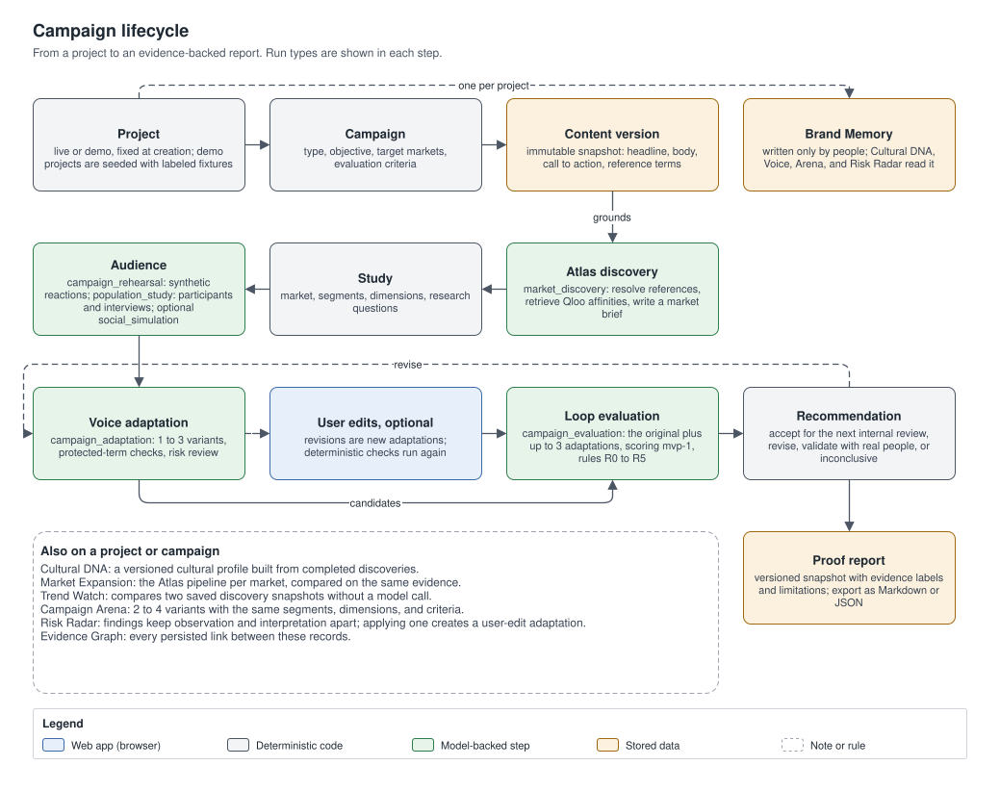

1. **Create a project.** Its mode is fixed at creation: a live project calls Qloo and the model providers; a demo project runs the same pipeline on labeled fixtures. Each project has one Brand Memory.
2. **Add a campaign** with its original content: headline, body, call to action, and reference terms. Every content edit creates a new, immutable content version, so results always point to the exact text they assessed.
3. **Discover with Atlas.** Reference terms are resolved against Qloo; related interests are retrieved for the target market; a market brief is written from that evidence only.
4. **Configure a study:** market, research questions, dimensions to rate, and segments.
5. **Rehearse with Audience:** a quick synthetic rehearsal, or a population study with 20 to 2,000 synthetic participants, interviews, follow-up questions, and an optional multi-round social simulation.
6. **Adapt with Voice:** one to three market variants with change explanations, deterministic term checks, and a risk review. People can edit any variant; an edit is saved as a new version.
7. **Compare with Loop:** the original and up to three adaptations are assessed by one model call under the same criteria, scored deterministically, and given a rule-based recommendation.
8. **Report with Proof:** a versioned report assembled from stored results, exportable as Markdown or JSON.

Tools used along the way: Cultural DNA, Market Expansion, Trend Watch, Campaign Arena, Risk Radar, project search, and the graph views. Long steps run in the background with named stages, and the page shows their progress.

## Reading the results: labels and confidence

Every evidence record has an `evidence_type` (what produced it) and a `claim_type` (its epistemic status). The UI derives one label from them, first match wins:

| UI label | Rule | Meaning |
|---|---|---|
| Observed outcome | `evidence_type = observed_outcome` | A real-world outcome recorded from an actual source |
| Synthetic | `evidence_type = synthetic_response` or `claim_type = synthetic` | AI-generated content, including simulated reactions |
| Calculated | `evidence_type = deterministic_calculation` | Computed by documented deterministic code |
| Unverified | `claim_type = hypothesis` | A claim that is not yet adequately supported |
| Model interpretation | `evidence_type = model_interpretation` | An explanation written by a model |
| Source data | `evidence_type` is `qloo_source`, `provider_result`, or `user_input` | Returned by a provider or entered by a person |

A retrieval badge shows where source data came from: **Live** (fetched for this run), **Cached** (a stored Qloo result, shown with its retrieval time), **Fixture** (labeled demo data), or **User input**. Calculations and interpretations carry no retrieval badge, because their label already says what they are.

Findings carry a confidence label computed by fixed rules. These labels describe evidence quality; they are not probabilities:

- **Moderate:** backed by at least one Qloo evidence record with claim type `observed`; rehearsal findings also need support from at least half of the reactions.
- **Limited:** supported only by synthetic reactions or model interpretation, or the moderate thresholds were not met. Findings whose claim type is `interpreted` or `hypothesis` are capped here.
- **Insufficient:** fewer than two supporting reactions and no source evidence, or no support at all.

There is no "high" label, because no observed real-world outcomes are recorded yet.

## Features

Each feature below covers what it does, why it matters, how it works, and what it does not claim. Limits quoted here come from the request schemas in [`backend/app/schemas/`](backend/app/schemas/).

- [Projects, campaigns, and content versions](#projects-campaigns-and-content-versions)
- [Atlas: market discovery](#atlas-market-discovery)
- [Cultural DNA](#cultural-dna)
- [Market Expansion](#market-expansion)
- [Trend Watch](#trend-watch)
- [Brand Memory](#brand-memory)
- [Audience: campaign rehearsal](#audience-campaign-rehearsal)
- [Audience Intelligence: population studies](#audience-intelligence-population-studies)
- [Participant memory, follow-ups, and group questions](#participant-memory-follow-ups-and-group-questions)
- [Multi-round social simulation](#multi-round-social-simulation)
- [Graph views and the Evidence Graph](#graph-views-and-the-evidence-graph)
- [Voice: cultural adaptation](#voice-cultural-adaptation)
- [Loop: version comparison](#loop-version-comparison)
- [Campaign Arena](#campaign-arena)
- [Risk Radar, image upload, and vision](#risk-radar-image-upload-and-vision)
- [Proof: reports and export](#proof-reports-and-export)
- [Project search](#project-search)
- [Demo mode](#demo-mode)
- [Background runs, cancel, resume, and recovery](#background-runs-cancel-resume-and-recovery)

### Projects, campaigns, and content versions

**What it does.** A project holds everything: its Brand Memory, campaigns, studies, runs, evidence, and reports. A campaign holds a campaign type, an objective, target markets, evaluation criteria weights, and a history of content versions.

**Why it matters.** A result is only useful if it is clear which text it assessed. Immutable versions make that unambiguous.

**How it works.** Content is a headline (up to 300 characters), a body (up to 5,000), a call to action (up to 200), and up to 20 reference terms. Saving new content creates version `n + 1`; earlier versions never change. Deleting a project archives it instead. Every row carries `project_id`, and composite foreign keys keep references inside one project (see [Data model](#data-model)).

**What it does not claim.** Archiving is not erasure: archived projects keep their records.

### Atlas: market discovery

**What it does.** Turns a product category, a target market, a research question, and up to 10 reference terms into Qloo-grounded cultural signals, a cultural signal map, and a market brief.

**Why it matters.** Every later step can be grounded in what Qloo actually returned instead of what a model assumes about a market. Atlas also shows plainly which terms could not be resolved.

**How it works.**

- Request (`POST /api/v1/projects/{project_id}/discoveries`): campaign, product category, market, research question, reference terms, optional `confirmed_references`, and options (`max_references` 1 to 20, default 10; whether to include related interests).
- Run type `market_discovery`, with stages `resolving_references`, `retrieving_affinities`, `normalizing_evidence`, and `generating_brief`.
- **Resolution.** Each term is looked up with Qloo's tag search or entity search. A term is `resolved` only when the top candidate's name is a near-exact, unique match for the term: equal after Unicode normalization, case folding, punctuation-to-space, whitespace collapse, and dropping a trailing plural "s" from words longer than three letters. Otherwise it is `ambiguous`, listing the top candidates, or `unresolved` when Qloo returned none. Ambiguous candidates are never used downstream. Entity search never resolves a venue automatically.
- **"Use this" confirmations.** For an ambiguous term, each candidate with an entity id has a **Use this** button. It reruns discovery with that choice in `confirmed_references` (`term`, `ref_id`, `ref_kind`), and the resolver uses the confirmed id instead of name matching. A confirmed term must also be one of the reference terms, otherwise the request fails with 422.
- **Related interests.** For resolved references, Qloo Insights returns related entities with the market as the audience-location signal. A relevance check keeps only results that carry the seed's own Qloo tag and records how many were dropped.
- **Evidence.** Every Qloo result becomes an evidence record: `evidence_type = qloo_source`, `claim_type = observed`, the retrieval mode (live, cached, or fixture), the retrieval time, limitations, and provenance (`request_hash`, `response_hash`, `normalizer_version`, and `fixture_origin` for fixtures). See [Qloo integration](#qloo-integration).
- **Cultural signal map.** A radial view of one discovery: the person's terms on the inner ring and their related interests on the outer ring, with a list view as an alternative. Selecting a signal opens its detail: the source data, the model's interpretation in a separate, labeled block, the brief findings that cite it, and its related interests.
- **Market brief.** A model writes the brief only from the supplied evidence: a model-written summary, observations, opportunities, risks, validation questions, and limitations. Each brief finding has a claim type, cited evidence ids, a confidence label, and a validation question. Code checks the claims: a finding marked `observed` must cite observed Qloo evidence, and confidence labels follow the rules above.

**What it does not claim.** Cultural affinity is not commercial demand, purchase intent, or market viability. A Qloo candidate is not proof of a match, which is why ambiguous terms wait for a person. Brief text that is not backed by observed evidence is labeled interpretation or hypothesis.

### Cultural DNA

**What it does.** Builds a versioned cultural profile of a subject across one to five markets, from up to five completed discoveries.

**Why it matters.** It condenses what the evidence says about a market into one reusable profile, with the evidence still attached to each item.

**How it works.** Request (`POST /api/v1/projects/{project_id}/cultural-profiles`): subject, title, optional campaign, markets, discovery run ids, an optional focus (up to 500 characters), and optionally `based_on_profile_id`. Run type `cultural_profile`, stages `loading_evidence`, `retrieving_context`, `synthesizing_profile`, and `checking_evidence`. A model writes the items; code then checks every one: unknown evidence handles are dropped, an `observed` item needs Qloo source evidence, and an item with no evidence becomes a hypothesis with confidence `insufficient`. The profile reads Brand Memory and records which rules it applied, but never writes to it. Regenerating with `based_on_profile_id` creates the next version under the same `lineage_id`; earlier versions are kept. People can edit only the title and notes.

**What it does not claim.** A profile does not describe everyone in a market. Items without evidence are explicitly hypotheses.

### Market Expansion

**What it does.** Compares two to five candidate markets for the same product category, research question, and reference terms.

**Why it matters.** It shows where usable evidence exists and where the gaps are before a team commits to a market.

**How it works.** Request (`POST /api/v1/projects/{project_id}/market-comparisons`). Run type `market_comparison`, stages `discovering_markets` (the Atlas pipeline for each market), `assessing_evidence` (evidence quality counted in code), `comparing_markets`, and `summarizing`. Each market appears as a column with its signals and evidence counts, and on a world map. A market with no data is `unavailable` and names the gap. When the verified Qloo signals do not differ between markets, `comparability.market_specific_signals` is false and the UI does not rank markets on those signals. Ambiguous terms are listed once, above the markets, with the same **Use this** buttons as Atlas. A choice reruns the comparison with `confirmed_references`; one confirmation applies to every market, because Qloo tag resolution does not depend on the market. The comparison shows the confirmations it used.

**What it does not claim.** It does not estimate market size or demand, and it never fills an empty column with invented insight.

### Trend Watch

**What it does.** Saves snapshots of finished discovery runs and compares two of them.

**Why it matters.** It shows what changed in the cultural signals between two observations without anyone redoing the analysis by hand.

**How it works.** A snapshot (`POST /api/v1/projects/{project_id}/snapshots`) is a labeled pointer to a finished discovery run, whose stored result is immutable; it records the market, terms, and counts. A comparison (`POST /api/v1/projects/{project_id}/trend-comparisons`) is synchronous and deterministic: no model is called. It is `comparable: false`, with notes, when the market, terms, or workflows differ. Implications are labeled hypotheses. With fewer than two snapshots the page shows an empty state.

**What it does not claim.** Two snapshots are two observations, not a trend line. Historical snapshots are never fabricated.

### Brand Memory

**What it does.** Stores the brand's rules: name, description, positioning, voice, communication style, target audience, audience preferences, preferred terms, prohibited terms, protected terms, up to 20 approved examples, and up to 20 constraints.

**Why it matters.** Generated work stays consistent with the brand, and each result records which rules it applied.

**How it works.** `GET` and `PUT /api/v1/projects/{project_id}/brand`; `PUT` replaces the whole brand. Only people write Brand Memory: no model output is ever saved into it. Cultural DNA, Voice, Campaign Arena, Risk Radar, and Market Expansion read the current brand, and their results list the rules they applied. When an embedding model is configured, the approved examples closest to the task are selected by similarity. Protected and prohibited terms are also enforced by deterministic checks in Voice and Risk Radar. In demo projects Brand Memory is read-only.

**What it does not claim.** Brand Memory is not learned from outputs; it contains only what people entered.

### Audience: campaign rehearsal

**What it does.** Runs a quick synthetic rehearsal of one content version in one market.

**Why it matters.** It surfaces likely confusion, risks, and disagreement early, before money is spent on real research.

**How it works.** A study (`POST /api/v1/projects/{project_id}/studies`) sets the market, one to five research questions, one to four dimensions (`clarity`, `brand_fidelity`, `cultural_relevance`, `cultural_risk`), up to four segments, and a simulation config: 3 to 24 responses (default 12), 1 to 4 segments (default 3), and a random seed (default 42). A rehearsal (`POST /api/v1/studies/{study_id}/rehearsals`) is run type `campaign_rehearsal`, stages `loading_context`, `generating_reactions`, `aggregating_results`, and `analyzing_reactions`. Each synthetic reaction rates every dimension from 1 to 5. Aggregation is deterministic (scoring version `mvp-1`): `score = round((mean - 1) / 4 * 100, 1)`; `spread` is the population standard deviation of the ratings; a dimension shows disagreement when there are at least three reactions and either the spread is at least 1.0 or at least a quarter of ratings are 2 or lower while another quarter are 4 or higher. Segment scores use the same formula. An analyst model then writes findings with confidence labels, disagreement clusters, and validation questions. A rehearsal grounded in a discovery run uses its evidence; one without discovery context records that it was ungrounded.

**What it does not claim.** Every reaction is labeled in the UI as an AI-generated reaction, not a real participant response. The number of reactions is not a sample size, and reactions from one model are not independent observations.

### Audience Intelligence: population studies

**What it does.** Builds a synthetic population of 20 to 2,000 participants grounded in Qloo evidence, interviews every participant about one content version, and tallies the answers by group and region.

**Why it matters.** A larger, structured population shows how reactions differ between audience groups and regions. Because a population can be reused, different content versions can be compared on the same participants.

**How it works.** Request (`POST /api/v1/studies/{study_id}/population-studies`):

- `population_size` (20 to 2,000) with up to five regions (default: the study's market), or `population_id` to reuse an existing population of the same campaign, which keeps its own size and regions. Reusing a population is how content versions are compared on identical participants.
- `content_version_id` (default: the campaign's current version), so any version can be tested.
- `discovery_run_id` (default: the campaign's latest linked discovery).
- `asset_id`: an optional image creative, analyzed only by a verified vision model.
- `interview_depth`: `brief`, `standard`, or `deep`; and `seed` (default 42).

A request larger than the deployment's work limit (`POPULATION_MAX_PARTICIPANTS`, default 600) is refused with 422 and the limit, never silently shrunk. Demo projects are capped at 120 participants.

Run type `population_study` has four stages:

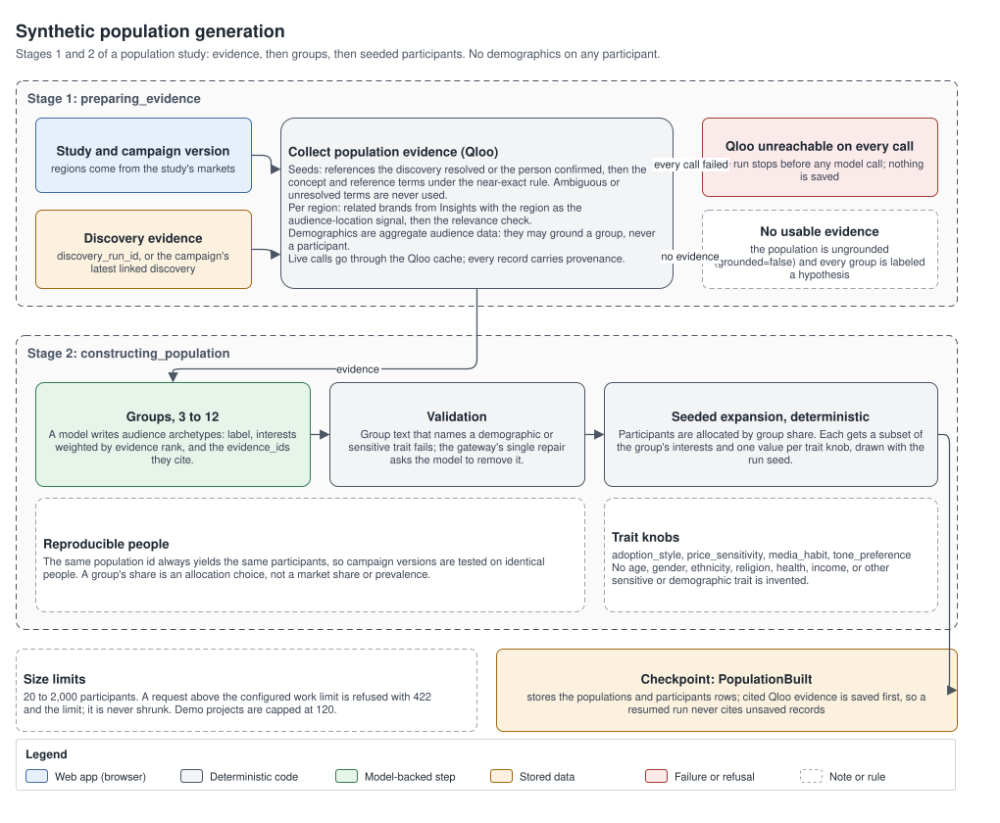

1. **`preparing_evidence`.** Qloo seeds are the references the discovery resolved or the person confirmed, then the concept and reference terms under the near-exact rule; ambiguous or unresolved terms are never used. For each region, related brands come from Qloo Insights with the region as the audience-location signal, filtered by the relevance check. Demographic data from Qloo is aggregate audience data: it may ground a group, never a participant. If every Qloo call fails, the run stops before any model call and saves nothing. If no usable evidence exists, the population is marked ungrounded (`grounded = false`) and every group is labeled a hypothesis.
2. **`constructing_population`.** A model writes 3 to 12 audience groups (archetypes): a label, interests weighted by evidence rank, and the evidence ids they cite. Group text that names a demographic or sensitive trait fails validation, and the gateway's single repair asks the model to remove it. Participants are then expanded deterministically from the groups with the run seed: each participant gets a subset of its group's interests and one value for each of four trait knobs (`adoption_style`, `price_sensitivity`, `media_habit`, `tone_preference`). No age, gender, ethnicity, religion, health, income, or other sensitive or demographic trait is ever assigned to a participant. A group's `share` is an allocation choice, not a market share.
3. **`running_interviews`.** See the next diagram. Participants are interviewed in batches of 10, up to three batches at a time, on the fast model tier. Every participant answers the core protocol about the actual content version: first impression, comprehension, relevance, appeal, confusion, trust, concerns, and improvement. `standard` depth adds one adaptive follow-up and `deep` adds two. A creative is shown only as verified vision observations. Each batch is saved as a checkpoint; a failed batch is stored as failed interviews and is not retried in a loop.
4. **`analysing_results`.** Tallies are deterministic counts over stored interviews: reaction distribution (positive, mixed, neutral, negative, confused) as `rates = counts / completed interviews`, with failed interviews reported beside them; themes, concerns, and misunderstandings; and the same by group and by region. A model then interprets the tallies (group differences and next actions), and that text is labeled interpretation.

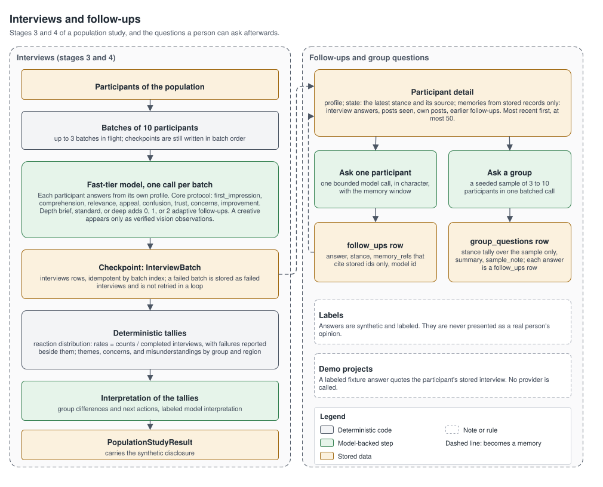

The Audience page shows the population form, the run's progress with **Cancel run** and **Resume from last checkpoint**, the reaction distributions, a world map of synthetic participants per region, the landscape graph and reaction map, and the stored interviews (`GET /api/v1/population-studies/{id}/interviews`, filterable by group, region, and reaction).

**What it does not claim.** Participants are AI personas, not a survey of real people. All participants share one model's biases, so agreement between them is not confirmation. Rates describe synthetic answers, not market prevalence.

### Participant memory, follow-ups, and group questions

**What it does.** Lets a person open any participant, see what it said and saw, and ask it, or a sample of its group, a follow-up question.

**Why it matters.** A tally says that a group was confused; a follow-up can ask why, while keeping every answer tied to stored history.

**How it works.**

- `GET /api/v1/population-studies/{id}/participants/{participant_id}` returns the profile, the participant's **state** (its latest stance and the source of that stance: the interview reaction, then any later social-round stance), and its **memories**. Memories are built only from stored records: its interview answers, the posts it saw, its own posts, and its earlier follow-up answers, most recent first, at most 50.
- `POST .../participants/{participant_id}/questions` asks one participant: one bounded model call, in character, using the profile and the memory window. The answer lists `memory_refs` that may cite stored ids only, and it is saved as a `follow_ups` row, so it becomes a memory itself.
- `POST .../groups/{group_id}/questions` asks a seeded sample of 3 to 10 participants (default 5) of one group in a single batched call. The `group_questions` row stores a stance tally over the sample only, a summary, and a `sample_note` that says so; each answer is also a `follow_ups` row.
- In demo projects the answer is a labeled fixture that quotes the participant's stored interview, with no provider call.

**What it does not claim.** Answers are synthetic and labeled as such; they are never presented as a real person's opinion. A group question's tally describes the sample, not the whole group.

### Multi-round social simulation

**What it does.** Runs up to five illustrative rounds in which participants of a finished population study see posts from their network peers, act, and restate their stance.

**Why it matters.** It shows how a reaction might spread or reverse inside and across groups, and every stance change can be traced to the exact posts the participant saw.

**How it works.** Request (`POST /api/v1/social-simulations`): a completed or partial population study, `rounds` 1 to 5 (default 3), `active_share` 0.05 to 0.5 (default 0.2), `feed_size` 2 to 10 (default 5), and a seed (default 42). Run type `social_simulation`, stages `building_network`, `simulating_rounds`, `analysing_dynamics`, and `summarizing`.

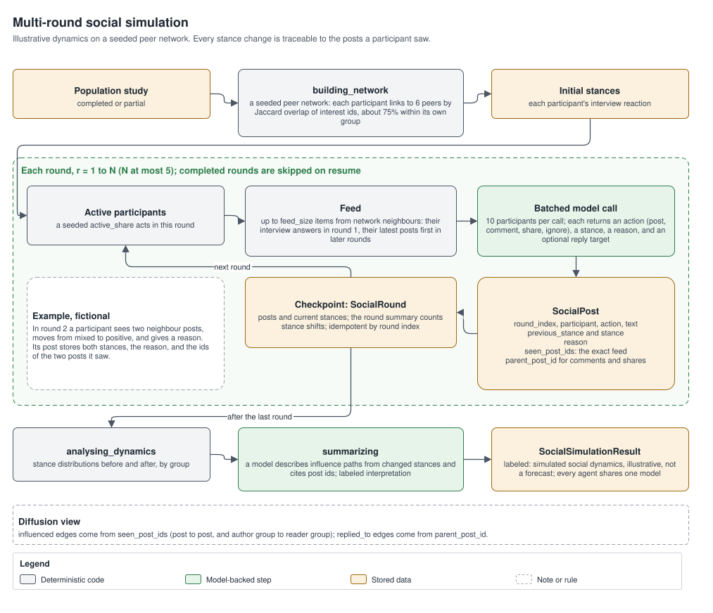

- **Peer network.** Seeded: each participant links to 6 peers ranked by the Jaccard overlap of their interest ids, about three quarters within its own group. The method is stored with the result.
- **Feeds.** In each round a seeded `active_share` of participants acts. Each sees up to `feed_size` items from its neighbours: their interview answers in round 1, and their latest posts first in later rounds.
- **Actions.** A batched model call (10 participants per call) returns, for each participant, an action (`post`, `comment`, `share`, or `ignore`), a stance, a reason, and an optional reply target.
- **Stored per post:** round, participant, action, text, `previous_stance`, `stance`, the stated `reason`, `seen_post_ids` (the exact feed), and `parent_post_id` for comments and shares.
- **Checkpoints.** Each round is saved as a checkpoint with a summary that counts stance shifts. Resuming replays saved rounds and skips them.
- **Results:** stance distributions before and after, by group; emergent themes; and influence paths, written by a model from the changed stances, citing post ids, and labeled interpretation.

The page shows a feed browser by round and group, the before-and-after distributions, and the diffusion graph, with **Resume from last round** for an interrupted run.

**What it does not claim.** Results carry the label "Simulated social dynamics: illustrative, not a forecast of real virality, reach, or behavior." They never claim real virality, reach, or market behavior, and the disclosure notes that every agent is voiced by the same model.

### Graph views and the Evidence Graph

**What it does.** Draws five graphs from stored records: four population views (landscape, reaction map, campaign comparison, social diffusion) and the project-wide Evidence Graph.

**Why it matters.** Relationships that a table hides, such as which groups share evidence or which campaign element drove a reaction, become visible, and every link can be checked against the field that stores it.

**How it works.** Graphs are built only from stored records: there are no hardcoded nodes or invented counts. Every node and edge has a stable id, every weighted edge states its `weight_definition`, and every edge states its `provenance`. Large results return a bounded, relevant subgraph with `truncated = true` and a limitation; the paginated list endpoints have the rest.

- **Landscape** (`GET /api/v1/populations/{id}/landscape`): audience groups as nodes with their regions and interests. `similar_to` edges use the cosine similarity of the groups' interest-weight vectors over shared Qloo ids and are drawn only above 0.2; `shares_evidence` links groups that cite the same evidence. When no defensible similarity exists, only shared-evidence edges appear.
- **Reaction map** (`GET /api/v1/population-studies/{id}/reaction-map`): campaign elements (headline, body, call to action, creative) linked to the groups that reacted to them, the stored themes they mention, reaction categories, cited evidence, and recommendations. It can be downloaded as JSON.
- **Campaign comparison** (`GET /api/v1/campaigns/{id}/population-comparison`): two to four population studies of the same population, as content versions by groups by reaction distributions. `consistent_population` and `consistent_protocol` say whether the comparison is like for like.
- **Social diffusion** (`GET /api/v1/social-simulations/{id}/diffusion`): group-to-group influence derived from `seen_post_ids`, plus a bounded participant and post subgraph for one round (`influenced` and `replied_to` edges).
- **Evidence Graph** (`GET /api/v1/projects/{id}/evidence-graph`, filters for campaign, region, evidence type, and node limit): campaigns, content versions, adaptations, evaluations, risk findings, cultural profiles, arenas, market comparisons, reports, runs, and evidence, linked by `variant_of`, `derived_from`, `generated_by`, `supports`, `evaluates`, `recommends`, `flags`, `references`, and `produced`.

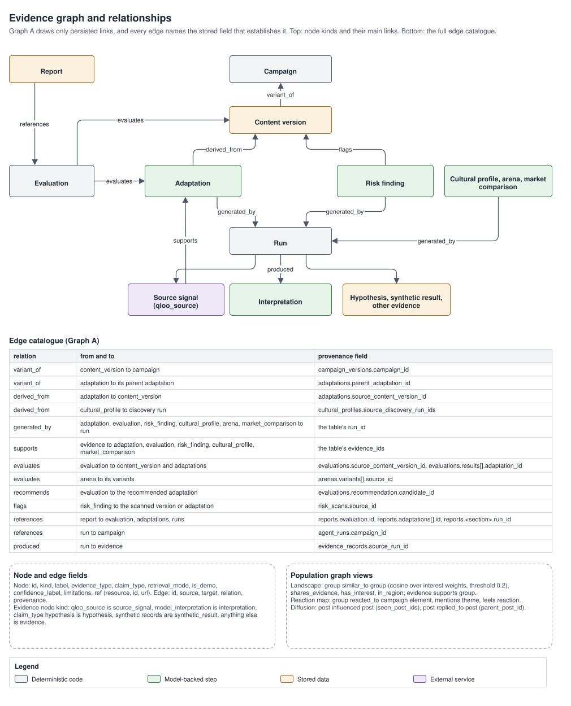

All graphs share one canvas: force, hierarchical, and regional layouts that are deterministic (the same input gives the same picture), layer toggles from the legend, label density control, a detail panel with each node's stored facts and its relations with their weight definitions and provenance, and keyboard traversal (arrow keys move between neighbours, Enter opens). On narrow screens the Evidence Graph opens as a text list, with the canvas one tap away.

**What it does not claim.** A link that is not persisted is never inferred or drawn. Similarity weights are not probabilities. Population studies are explored in their own graph views (reaction map, audience landscape, social diffusion, and campaign comparison), which are built the same way.

### Voice: cultural adaptation

**What it does.** Produces one to three market-specific variants of a content version, each with per-field change explanations, deterministic term checks, and a risk review.

**Why it matters.** It adapts references and tone for a market while making every change visible and protecting the brand's terms.

**How it works.** Request (`POST /api/v1/campaigns/{campaign_id}/adaptations`): the source content version (default: current), market, optional discovery and rehearsal runs for grounding, `variant_count` 1 to 3 (default 3), instructions (up to 1,000 characters), and protected terms that are merged with the brand's. Run type `campaign_adaptation`, stages `loading_context`, `generating_adaptations`, `checking_constraints`, and `reviewing_risks`. The constraint checks are deterministic and case-insensitive: a protected term that appears in the source must appear verbatim in the adaptation, and any prohibited term found is flagged; either one counts as a violation. A Red Team model on the reasoning tier then reviews each variant for risks. Model output that fails validation is never saved, and the result says so. A person can edit any variant (`POST /api/v1/adaptations/{id}/revisions`, with an optional note); the edit is saved as a new `user_edit` adaptation and only the deterministic checks run again.

**What it does not claim.** Voice is not a translator, and a cultural affinity match is not proof that two references have the same meaning or emotional weight.

### Loop: version comparison

**What it does.** Assesses the original and up to three adaptations under the same criteria and returns a deterministic recommendation with the rule that produced it.

**Why it matters.** Comparisons are consistent and reproducible, and a reader can see exactly why a version was recommended.

**How it works.** Request (`POST /api/v1/campaigns/{campaign_id}/evaluations`): the source content version, one to three candidate adaptations, market, criteria weights, and context. Weights must sum to 1.0 within 0.001, otherwise the request fails with 422; they are never normalized. Defaults: clarity 0.30, brand fidelity 0.25, cultural relevance 0.30, cultural risk 0.15. Run type `campaign_evaluation`, stages `loading_candidates`, `assessing_candidates`, `scoring`, and `recommending`. One model call assesses every candidate with the same prompt and criteria, giving each dimension an integer from 0 to 100 with a rationale. Scoring is code: utility equals the score, except `utility_cultural_risk = 100 - score_cultural_risk`, and `overall = round(sum(weight * utility), 1)`, which is null if any dimension is missing. The best candidate has the highest overall; ties go to lower cultural risk, then request order. The recommendation is the first rule that matches:

| Rule | Condition | Decision |
|---|---|---|
| R0 | Any score missing for the original or the best candidate | `inconclusive` |
| R1 | The best candidate has a constraint violation, a high-severity risk flag, or cultural risk of 60 or more | `revise` |
| R2 | Best overall below the original's | `revise` |
| R3 | Best minus original below 5 points | `validate` |
| R4 | Best overall 70 or more and cultural risk below 40 | `accept` |
| R5 | Otherwise | `validate` |

The comparison table marks differences under 5 points as not meaningful.

**What it does not claim.** `accept` means "ready for the next internal review", not proof of market success. A higher score from one model is not proof that a version is better; `validate` recommends checking with real people.

### Campaign Arena

**What it does.** Rehearses two to four variants against the same study's segments, dimensions, and criteria, side by side.

**Why it matters.** Variants from different sources (the original, Voice adaptations, or custom copy) are compared under identical conditions.

**How it works.** Request (`POST /api/v1/campaigns/{campaign_id}/arenas`): a study, two to four variants (each exactly one of a content version, an adaptation, or custom content, plus an optional image creative), criteria, an optional discovery run, and 3 to 12 responses per variant (default 6). Run type `campaign_arena`, stages `loading_variants`, `analyzing_creatives` (images go only to a verified vision model), `generating_reactions`, and `scoring_variants` (the `mvp-1` aggregation). Suggested improvements are labeled interpretations or hypotheses. A person can mark a preferred variant (`PATCH /api/v1/arenas/{id}`), and the results page links to Voice and Proof for the same campaign. Arena results are not part of Proof reports.

**What it does not claim.** Choosing a preferred variant is not approval, and scores aggregate synthetic ratings only. In demo projects, custom variants have null scores with a limitation.

### Risk Radar, image upload, and vision

**What it does.** Scans a content version, an adaptation, or custom text, together with up to three uploaded images, for cultural and brand risks in a market.

**Why it matters.** It flags problems before launch and keeps what was actually seen separate from what a model thinks it means.

**How it works.** Request (`POST /api/v1/campaigns/{campaign_id}/risk-scans`): market, one source, up to three asset ids, and an optional discovery run. Run type `risk_scan`, stages `loading_content`, `analyzing_creatives`, `assessing_risks`, and `checking_evidence`. Risks come from deterministic brand checks and from a model on the reasoning tier that must quote exact excerpts. Code verifies every excerpt and visual observation; a finding whose excerpt or observation cannot be found is dropped. Each finding has a category, severity, confidence label, source, text location or visual observation, the **observation** (exact text or a visible element), the **interpretation** (a model assessment, unless it came from a deterministic check), the brand rule involved, evidence ids, limitations, and a suggested alternative. Findings start `open`; a person can dismiss, resolve, or reopen them with a note. Applying an alternative (`POST .../findings/{finding_id}/apply`) creates a user-edit adaptation and marks the finding `applied`; the campaign itself is never edited in place.

- **Uploads** (`POST /api/v1/projects/{project_id}/assets`, multipart `file` plus `kind`): images only, PNG, JPEG, or WebP up to `MAX_IMAGE_BYTES` (5 MB by default). The type is read from the file's content (magic bytes), not from its name or header. Stored names are server-generated (`{owner_id}/{asset_id}`), the bytes live in the database or in a private Supabase Storage bucket, and files are served only through the authenticated `GET /api/v1/assets/{id}/content`.
- **Vision.** Images go only to models that passed real image inference and are listed in the vision registry. If no such model is configured, or the call fails, the vision status is `unavailable` or `failed` with a message and the text analysis still runs. An image is never sent to a text-only model. Visual observations describe what is visible; cultural readings of them are interpretations.

**What it does not claim.** Risk Radar is not a legal or regulatory review, and its interpretations are model assessments to be checked by people. In demo projects uploads are not analyzed.

### Proof: reports and export

**What it does.** Assembles a versioned report from stored results: a discovery, a rehearsal, up to three adaptations, and an evaluation.

**Why it matters.** The report is the record of a study: what ran, on which version, with which models and evidence, and what is still missing.

**How it works.** Request (`POST /api/v1/projects/{project_id}/reports`): campaign, title, and the runs to include. Assembly is synchronous and deterministic: no model is called. A report contains the market, an executive summary, the campaign, discovery, rehearsal, adaptations, evaluation, an evidence register, limitations, validation steps, `missing_sections`, and reproducibility details (run metadata, scoring version, model ids, prompt versions, and notes). A section whose stage was not requested, did not finish, or failed is omitted, named in `missing_sections`, and makes the report `partial`. Reports are numbered per campaign. Export with `GET /api/v1/reports/{id}/export?format=markdown` or `format=json`; both are downloads that keep every evidence label and retrieval badge, and a demo report's export starts with a DEMO DATA banner. The viewer also flags reports whose sections used different content versions.

**What it does not claim.** A report documents a study; it is not validation with real people, which is why it lists validation steps.

### Project search

**What it does.** Semantic search over a project's stored content: evidence, Brand Memory examples, risk findings, Cultural DNA items, and adaptations.

**Why it matters.** It finds related material by meaning across features.

**How it works.** `GET /api/v1/projects/{project_id}/search?q=`, or Ctrl K in the workspace header. Each search first syncs the project's content into the index; content hashing means only new or changed sources are embedded, and removed sources leave the index. The sync compares hashes without loading vectors, so a search reads the stored vectors once, to rank them. Embeddings are stored with their model, dimensions, and configuration version, and vectors from different spaces are never compared.

**What it does not claim.** Similarity scores are not probabilities. Demo projects, and live projects without an embedding model, report search as `unavailable`; there is no keyword fallback dressed up as semantic search.

### Demo mode

**What it does.** "Try the demo" creates a project seeded with one fictional, labeled scenario (the brand Northstar, the campaign "Autumn Launch Campaign", the market Japan) so anyone can walk through the whole product without provider credentials.

**Why it matters.** The product can be evaluated even when no live provider is available, without mixing demo records into live research.

**How it works.** `POST /api/v1/projects/demo` seeds the brand, campaign, and study. Demo projects run the real pipeline (validation, aggregation, scoring, persistence) through a fixture Qloo service and a fixture model provider, so results are deterministic. Evidence has `is_live_data = false`, retrieval mode `fixture` or `generated`, and `fixture_origin` in its provenance; every run's mode is `demo`, and its step traces name `fixture` or `nativeproof` as the provider. The fixtures describe only the seeded scenario, so in a demo project:

- Creating campaigns or studies, editing the brand or campaign content, and runs for any market other than Japan return 409.
- Discovery accepts any terms; terms without a fixture come back unresolved with "No demo fixture for this term."
- Rehearsals, adaptations, and population studies are capped by the fixtures (population studies at 120 participants); edited text cannot be scored, so its evaluation is R0 `inconclusive`.
- Uploads are not analyzed and search is unavailable.

The UI shows a persistent DEMO DATA indicator, and evidence is labeled Fixture.

**What it does not claim.** Fixture output is never presented as live research, and a demo run never calls an external provider.

### Background runs, cancel, resume, and recovery

**What it does.** Runs every long step as a background task with named stages, persisted progress, cancellation, and resumable checkpoints for population studies and social simulations.

**Why it matters.** Pages can reload mid-run, a person can stop a run, and a restart of the free-tier host does not silently lose saved work.

**How it works.**

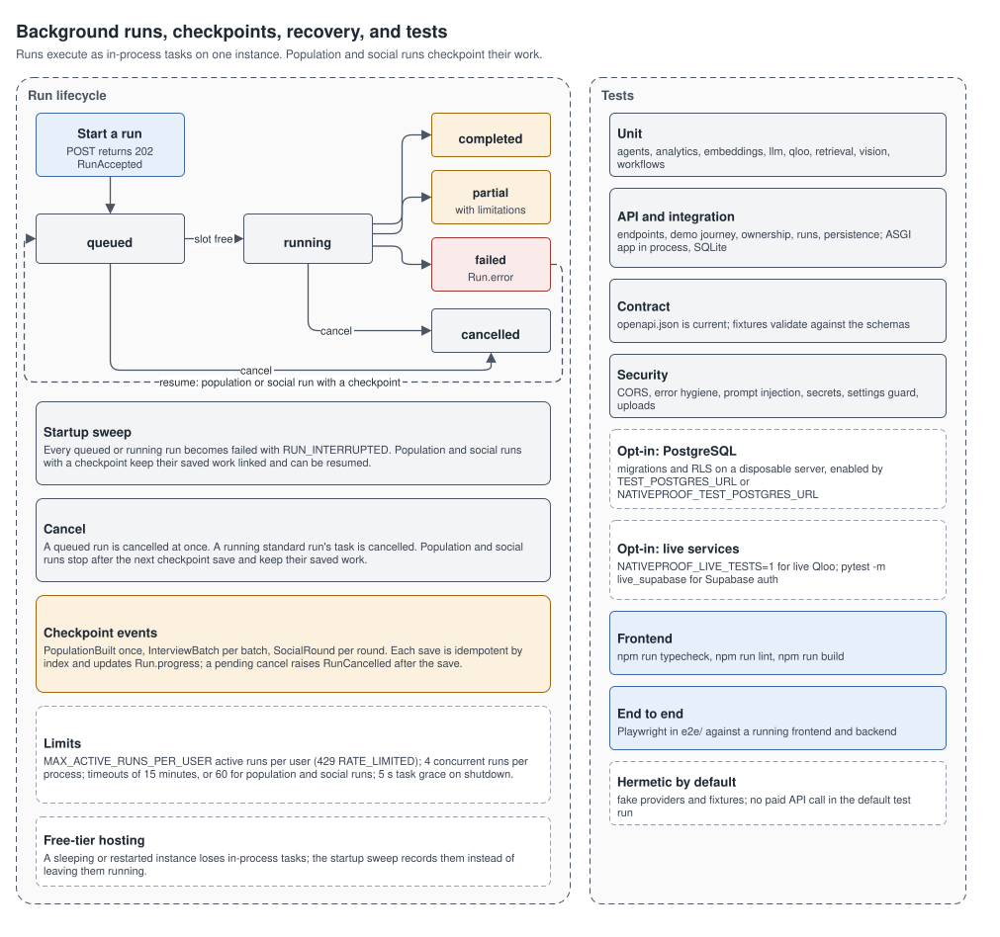

- Starting a run returns `202` with a `RunAccepted` body. Clients poll `GET /api/v1/runs/{id}` every 1.5 s for the first 30 s, then every 5 s, until a terminal status: `completed`, `partial`, `failed`, or `cancelled`. A `partial` run has a result whose limitations name the missing parts; a `failed` run carries `Run.error` with a code, message, stage, and a retryable flag.
- Runs execute as in-process tasks: at most 4 at a time per process, and at most `MAX_ACTIVE_RUNS_PER_USER` active runs per user (429 `RATE_LIMITED` beyond that). Standard runs time out after 15 minutes; population studies and social simulations after 60.
- **Checkpoints.** Population studies save `PopulationBuilt` once, then `InterviewBatch` per batch; social simulations save `SocialRound` per round. Each save is idempotent by its index and updates the run's progress.
- **Cancel** (`POST /api/v1/runs/{id}/cancel`): a queued run is cancelled at once; a running standard run's task is cancelled; a running population study or social simulation stops right after its next checkpoint save and keeps the saved work. Cancelling a finished run returns 409.
- **Resume** (`POST /api/v1/runs/{id}/resume`): only a failed or interrupted population study or social simulation that saved a checkpoint can be resumed. Completed batches and rounds are never redone.
- **Startup recovery.** When the API starts, every run still marked queued or running is marked failed with `RUN_INTERRUPTED`. Population and social runs with a checkpoint keep their saved work linked and are marked retryable, so they can be resumed.

**What it does not claim.** Execution is not durable across restarts: in-process tasks are lost when the instance stops, and only checkpointed work survives. Runs are tied to one instance; the design does not scale horizontally.

## Architecture

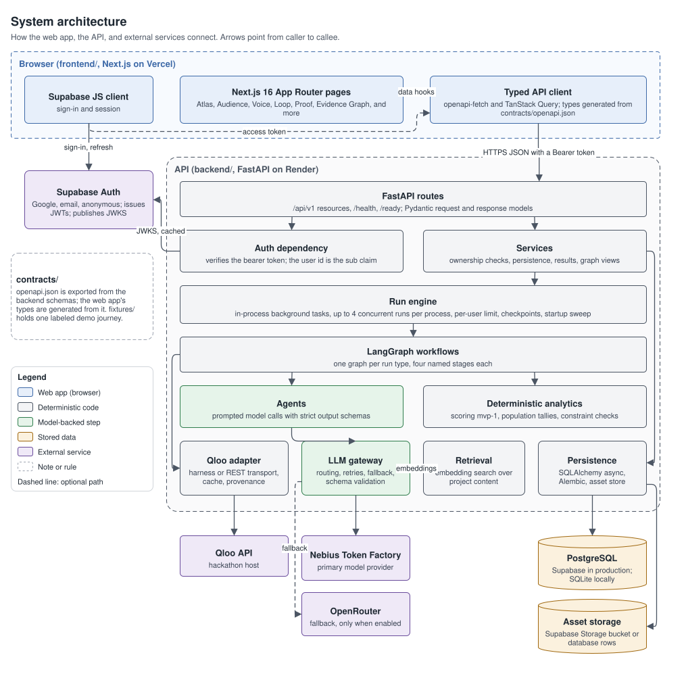

- **Web app** ([`frontend/`](frontend/)): Next.js 16 (App Router, Cache Components), React 19, TypeScript, Tailwind CSS 4, shadcn/ui on Base UI, TanStack Query, and openapi-fetch. API types are generated from [`contracts/openapi.json`](contracts/openapi.json) with openapi-typescript. Graphs use @xyflow/react with deterministic d3-force layouts; maps use d3-geo with Natural Earth shapes from world-atlas. The browser receives only `NEXT_PUBLIC_*` settings.
- **API** ([`backend/`](backend/)): FastAPI on Python 3.13, Pydantic request and response models, SQLAlchemy 2 (async), Alembic, LangGraph workflows, the OpenAI SDK against OpenAI-compatible providers, and PyJWT. Layers: routes, an auth dependency, services (ownership checks, persistence, results, graph views), the run engine, workflows, agents (model calls with strict schemas), deterministic analytics (scoring, tallies, constraint checks), and adapters for Qloo, the model gateway, retrieval, and storage. Routes live under `/api/v1`; `/health` (GET and HEAD) and `/ready` have no prefix. `/ready` reports the database, providers, and optional capabilities, and returns 503 when the service is not ready. Interactive API docs are served in development only.
- **Contract** ([`contracts/`](contracts/)): `openapi.json` is exported from the backend schemas (`uv run python -m scripts.export_openapi`), and `fixtures/` holds one consistent, schema-valid demo journey. Backend contract tests fail when either is stale.
- **Data and services:** PostgreSQL on Supabase in production (SQLite for local development and tests), Supabase Auth, Supabase Storage for uploads, Qloo, Nebius Token Factory, and optionally OpenRouter.

Every response carries an `X-Request-ID` header; errors use one envelope, `{"error": {"code", "message", "details", "request_id"}}`, without stack traces or provider details. Logs are one JSON object per line with request correlation.

## AI workflows

Each run type is a LangGraph state graph with four named stages. A stage either calls a model through the gateway or runs deterministic code, and each records a `StepTrace` (stage, agent, provider, model id, prompt and schema versions, latency, retries, fallback use, sampling, token usage, and error code) that Proof reports display.

| Run type | Feature | Stages | Model tier of the model steps |
|---|---|---|---|
| `market_discovery` | Atlas | resolving_references, retrieving_affinities, normalizing_evidence, generating_brief | default (brief) |
| `campaign_rehearsal` | Audience | loading_context, generating_reactions, aggregating_results, analyzing_reactions | default |
| `campaign_adaptation` | Voice | loading_context, generating_adaptations, checking_constraints, reviewing_risks | default; reasoning (risk review) |
| `campaign_evaluation` | Loop | loading_candidates, assessing_candidates, scoring, recommending | default |
| `cultural_profile` | Cultural DNA | loading_evidence, retrieving_context, synthesizing_profile, checking_evidence | default |
| `market_comparison` | Market Expansion | discovering_markets, assessing_evidence, comparing_markets, summarizing | default |
| `campaign_arena` | Campaign Arena | loading_variants, analyzing_creatives, generating_reactions, scoring_variants | default; vision |
| `risk_scan` | Risk Radar | loading_content, analyzing_creatives, assessing_risks, checking_evidence | reasoning; vision |
| `population_study` | Audience Intelligence | preparing_evidence, constructing_population, running_interviews, analysing_results | default (groups, analysis); fast (interviews) |
| `social_simulation` | Social simulation | building_network, simulating_rounds, analysing_dynamics, summarizing | fast (rounds); default (influence paths) |

The division of labor is deliberate: models write language (briefs, reactions, adaptations, interpretations), and code does everything that can be computed (resolution rules, relevance checks, scoring, tallies, constraint checks, excerpt verification, graph edges, report assembly). Model output and retrieved content are treated as untrusted input: prompts wrap source material as data, and every output is validated against a strict schema before it is used.
## Qloo integration

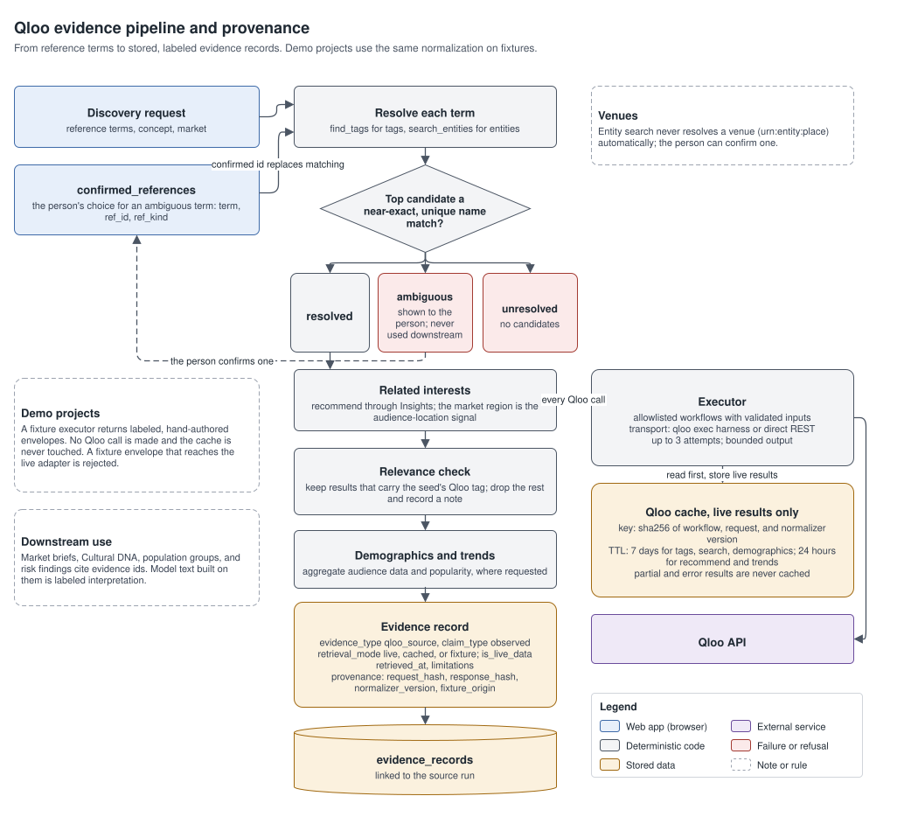

- **Workflows.** Only an allowlist of verified workflows ever runs: tag search, entity search, related-entity recommendations through Insights, aggregate audience demographics, and popularity trends. Inputs are validated before any call: search terms must be 1 to 100 characters without control characters, terms that look like an email address or phone number are refused, and workflow names never come from user input.
- **Transports.** The official hackathon harness (`qloo exec`, `@qloo/qloo-harness` pinned in [`backend/qloo/`](backend/qloo/)) when Node and the harness are installed, or direct REST otherwise; `QLOO_TRANSPORT` can force either. The hosted API runs on Render with `QLOO_TRANSPORT=rest`. Each call gets up to three attempts with bounded output. The harness subprocess receives only `PATH` and basic OS variables (no database URL or model keys) and a fresh, empty `QLOO_HOME` per run.
- **Cache.** Live results only. The key is a SHA-256 of the workflow, the request, and the normalizer version. Tag search, entity search, and demographics are cached for 7 days; recommendations and trends for 24 hours. Partial, degraded, and error results are never cached, expired entries are never served, and a cache problem never fails a lookup. A cached result's evidence says when it was retrieved.
- **Provenance.** Evidence from a live or cached result carries the request hash and response hash, so a record can be matched to the exact Qloo exchange; hand-authored fixtures carry `fixture_origin` instead, and a fixture envelope that reaches the live adapter is rejected.
- **Hackathon API constraints.** The event key belongs to the hackathon host, set through `QLOO_BASE_URL`. Requests are bounded (at most 10 terms per discovery, at most 20 references, and at most 5 seed terms for a population), cached, and never repeated in bulk. No personal data is sent to Qloo. Qloo response data is never committed to the repository; the live smoke script writes its report to a local file that is ignored by Git.

## Model gateway and routing

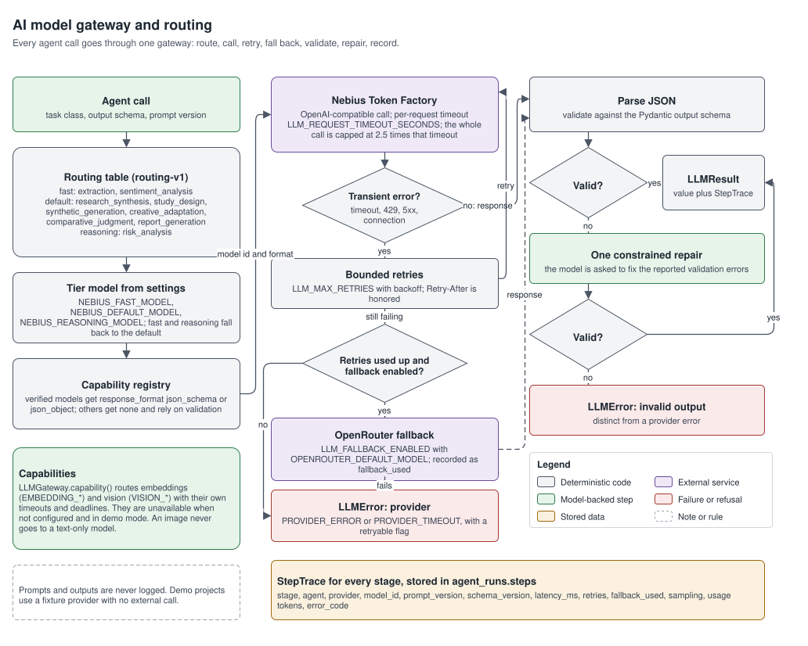

**What it does.** Every model call in the product goes through one gateway ([`backend/app/llm/gateway.py`](backend/app/llm/gateway.py)) that routes the task, calls the provider with bounded retries and timeouts, falls back when explicitly enabled, validates structured output, and records usage.

**Why it matters.** Provider behavior, failures, and costs are handled in one place, and every result can name the model that produced it.

**How it works.**

1. **Route.** The agent names a task class; the routing table (`routing-v1`) maps it to a tier:

   | Tier | Task classes |
   |---|---|
   | fast | extraction, sentiment_analysis |
   | default | research_synthesis, study_design, synthetic_generation, creative_adaptation, comparative_judgment, report_generation |
   | reasoning | risk_analysis |

   The tier model comes from `NEBIUS_FAST_MODEL`, `NEBIUS_DEFAULT_MODEL`, or `NEBIUS_REASONING_MODEL`; fast and reasoning fall back to the default model when unset.
2. **Format.** A capability registry records the models verified with real inference and whether each accepts a JSON schema or JSON object response format. Unlisted models get no response format and rely on prompt instructions plus validation.
3. **Call.** Nebius Token Factory through its OpenAI-compatible API, with a per-request timeout (`LLM_REQUEST_TIMEOUT_SECONDS`) and a cap on the whole call of 2.5 times that timeout. Timeouts, 429 responses (honoring `Retry-After`), 5xx responses, and connection errors are retried up to `LLM_MAX_RETRIES` times with backoff.
4. **Fall back.** Only when `LLM_FALLBACK_ENABLED` is true and an OpenRouter model is configured; the trace records `fallback_used`.
5. **Validate and repair.** The response is parsed and validated against the Pydantic output schema. One constrained repair asks the model to fix the reported errors. If the output is still invalid, the gateway raises an error that is distinct from a provider error.
6. **Record.** A `StepTrace` with provider, model, latency, retries, fallback use, sampling, and token usage is stored on the run. Prompts and outputs are never logged.

Capabilities beyond chat go through the same gateway: embeddings (`EMBEDDING_*`) and vision (`VISION_*`), each with its own per-request timeout and deadline. A capability that is not configured is reported as unavailable instead of being replaced by another model. Demo projects use a fixture provider that makes no external call.

**What it does not claim.** A model's self-reported certainty is never shown as a probability, and a provider is reported as configured only when its settings are present.

## Data model

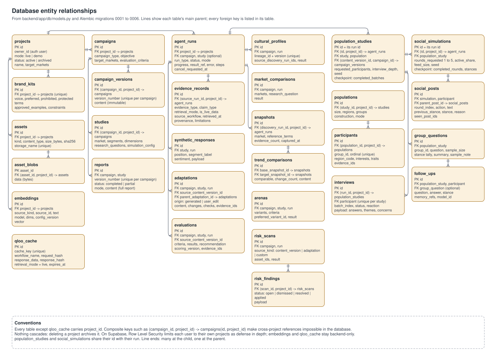

The schema is defined in [`backend/app/db/models.py`](backend/app/db/models.py) and created by the Alembic migrations in [`backend/migrations/versions/`](backend/migrations/versions/).

| Area | Tables |
|---|---|
| Core | `projects`, `brand_kits`, `campaigns`, `campaign_versions`, `studies`, `agent_runs`, `evidence_records` |
| Results | `synthetic_responses`, `adaptations`, `evaluations`, `reports` |
| Research tools | `cultural_profiles`, `market_comparisons`, `snapshots`, `trend_comparisons`, `arenas`, `risk_scans`, `risk_findings` |
| Assets and search | `assets`, `asset_blobs`, `embeddings` |
| Populations | `populations`, `participants`, `population_studies`, `interviews`, `social_simulations`, `social_posts`, `group_questions`, `follow_ups` |
| Cache | `qloo_cache` |

Conventions:

- `projects.owner_id` is the Supabase user id. Every other table except `qloo_cache` carries `project_id`, and composite foreign keys such as `(campaign_id, project_id) -> campaigns(id, project_id)` make cross-project references impossible in the database itself.
- Nothing cascades; deleting a project archives it.
- `population_studies` and `social_simulations` share their primary key with their run. Their `checkpoint` JSON (`completed_batches`, `completed_rounds`, and stances) makes resume idempotent.
- Generated resources store their outcome payload in a `result` JSON column once the run finishes; their status is always read from the run.
- Check constraints pin enumerations (run types, statuses, modes, interview depth, social actions, and round limits), and a live-data flag can only be true for live or cached evidence.

## Authentication

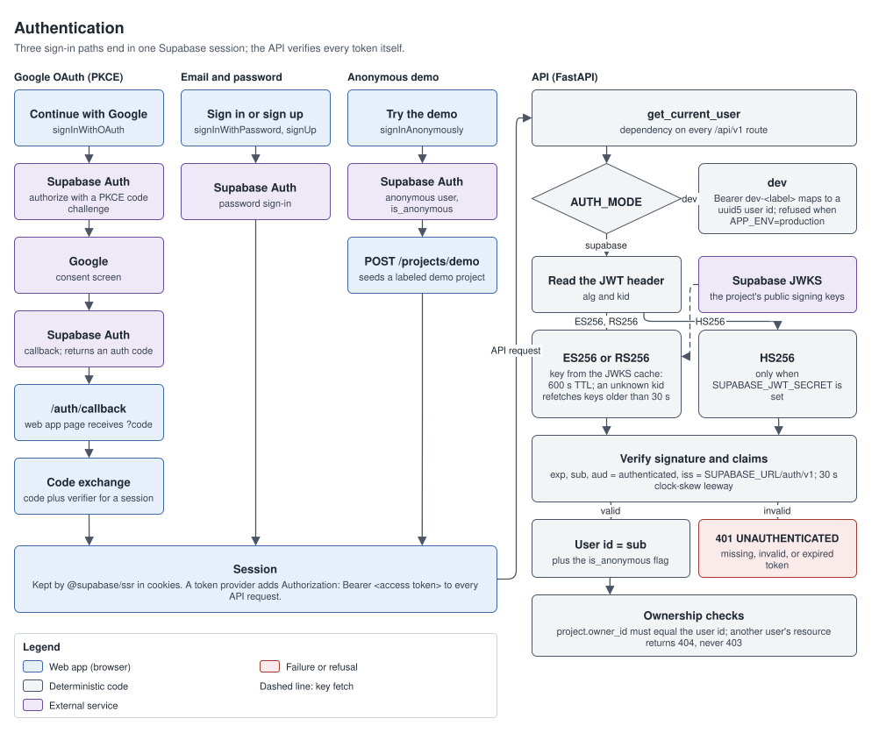

- **Sign-in** happens in the browser with Supabase Auth: **Continue with Google** (OAuth with PKCE; Supabase returns to `/auth/callback`, where the code is exchanged for a session), email and password, or **Try the demo**, which signs in anonymously and seeds a demo project.
- **Session.** `@supabase/ssr` keeps the session in cookies. A token provider adds `Authorization: Bearer <access token>` to every API request; the API never uses cookies.
- **Verification.** With `AUTH_MODE=supabase`, the API verifies each token itself. ES256 and RS256 tokens are checked against the project's JWKS (`{SUPABASE_URL}/auth/v1/.well-known/jwks.json`), cached for 600 seconds; an unknown key id triggers a refetch once the cached keys are more than 30 seconds old, and cached keys are kept if a fetch fails. HS256 is accepted only when `SUPABASE_JWT_SECRET` is set. The token must carry `exp`, `sub`, `aud = authenticated`, and `iss = {SUPABASE_URL}/auth/v1`, with 30 seconds of clock-skew leeway. The user id is `sub`.
- **Development mode.** With `AUTH_MODE=dev`, a token `dev-<label>` maps to a stable user id derived from the label, so tests can act as different users. The API refuses to start in this mode when `APP_ENV=production`.

## Security model

**What it protects.** Provider keys and database credentials, each user's research, and the integrity of results against injected instructions.

**How it works.**

- **Secrets.** All credentials are server-side environment variables. Settings hold them as secret types that never print, settings validation errors never echo input, and the JSON logger replaces configured secret values and bearer tokens with `[REDACTED]`. The browser receives only `NEXT_PUBLIC_*` values: the API URL, the auth mode, the Supabase URL, and the publishable key.
- **Authorization.** The backend enforces ownership on every request: a resource owned by another user returns 404, never 403, so its existence is not revealed. A reference in a request body to another user's resource returns 404; to the caller's own resource in a different project or campaign, or to a run of the wrong type or state, it returns 409.
- **Database defense in depth.** The API connects as the table owner and enforces ownership in code. On Supabase, Row Level Security lets an authenticated user read only rows of projects they own through the Data API, and nobody can write through it; `qloo_cache` and `embeddings` are backend-only. Storage policies limit each user to their own folder in the private `assets` bucket, and the API reaches Storage only with the server-side secret key.
- **Input validation.** Request models reject unknown fields with 422 and enforce the limits quoted in this README. Uploads are typed by magic bytes, size-limited, and stored under server-generated names.
- **Untrusted content.** Campaign copy, uploaded content, retrieved evidence, and model output are treated as data. Prompts wrap them as untrusted input, instructions inside them cannot change system behavior or grant tools, outputs are validated against strict schemas, and quoted excerpts are verified in code. Agents have no database, filesystem, network, or code-execution access of their own.
- **External calls.** Qloo workflows are allowlisted with validated inputs. Search terms that look like an email address or a phone number are refused before anything reaches Qloo, and the harness subprocess gets a minimal environment.
- **Abuse limits.** At most `MAX_ACTIVE_RUNS_PER_USER` active runs per user; bounded requests to Qloo and the model providers; bounded graph sizes.
- **Transport and browser.** CORS allows only the origins in `FRONTEND_ORIGINS`, with explicit methods and headers. Interactive API docs are disabled in production.

**What it does not claim.** The app has not had an independent security audit, and it relies on Supabase, Render, and Vercel for platform security.

## Local setup

Prerequisites: [uv](https://docs.astral.sh/uv/) (it installs Python 3.13 from `backend/.python-version`), and Node.js 22.19 or newer (the web app needs Node.js 20.9 or newer; the optional Qloo harness needs 22.19).

**API**

```bash
cd backend
cp .env.example .env              # SQLite, AUTH_MODE=dev, no provider keys
uv sync
uv run alembic upgrade head
uv run uvicorn app.main:app --reload --port 8000
```

Optional: install the Qloo harness for the harness transport with `cd backend/qloo && npm ci`. Without it, the API uses direct REST.

**Web app**

```bash
cd frontend
cp .env.example .env.local        # API at http://localhost:8000, NEXT_PUBLIC_AUTH_MODE=dev
npm ci
npm run dev                       # http://localhost:3000
```

With no provider keys, demo projects work end to end, and starting a live run returns `503 PROVIDER_NOT_CONFIGURED`. Add `QLOO_API_KEY` and `NEBIUS_API_KEY` (plus model ids) to `backend/.env` for live research.

**After changing an API schema**

```bash
cd backend
uv run python -m scripts.export_openapi          # writes contracts/openapi.json
uv run python -m scripts.build_contract_fixtures # rewrites contracts/fixtures
cd ../frontend
npm run gen:api                                  # regenerates src/lib/api/schema.d.ts
```

**Checks against live providers**

```bash
cd backend
uv run python -m scripts.qloo_live_smoke    # Qloo credential and transport; writes a local, Git-ignored report
uv run python -m scripts.verify_inference   # structured output from the configured Nebius models
```

## Environment variables

Names and purposes only; values belong in `backend/.env` and `frontend/.env.local`, which are never committed.

**API** ([`backend/.env.example`](backend/.env.example), all server-side)

| Name | Purpose |
|---|---|
| `APP_ENV` | `development`, `test`, or `production`; production disables the interactive docs and refuses `AUTH_MODE=dev` |
| `LOG_LEVEL` | Log level for the JSON logs |
| `FRONTEND_ORIGINS` | Comma-separated CORS allow-list of web app origins |
| `AUTH_MODE` | `supabase` to verify Supabase tokens, or `dev` for local development tokens |
| `SUPABASE_URL` | Supabase project URL; the JWKS URL, the token issuer, and Storage derive from it |
| `SUPABASE_JWT_SECRET` | Optional; only for projects that still sign tokens with the legacy HS256 secret |
| `DATABASE_URL` | SQLAlchemy async URL: SQLite locally, PostgreSQL with asyncpg in production |
| `LLM_PRIMARY_PROVIDER` | Primary model provider (`nebius`) |
| `NEBIUS_API_KEY` | Nebius Token Factory credential |
| `NEBIUS_BASE_URL` | Nebius OpenAI-compatible endpoint |
| `NEBIUS_DEFAULT_MODEL` | Model for the default tier |
| `NEBIUS_FAST_MODEL` | Model for the fast tier (falls back to the default model) |
| `NEBIUS_REASONING_MODEL` | Model for the reasoning tier (falls back to the default model) |
| `LLM_FALLBACK_ENABLED` | Enables the recorded OpenRouter fallback |
| `OPENROUTER_API_KEY` | OpenRouter credential for the fallback |
| `OPENROUTER_BASE_URL` | OpenRouter endpoint |
| `OPENROUTER_DEFAULT_MODEL` | Fallback model |
| `LLM_REQUEST_TIMEOUT_SECONDS` | Timeout of one model request; a whole call is capped at 2.5 times this |
| `LLM_MAX_RETRIES` | Retries for transient provider errors |
| `QLOO_API_KEY` | Qloo credential; setting it enables live Qloo calls |
| `QLOO_BASE_URL` | Qloo host; blank for the default host, or the hackathon host for an event key |
| `QLOO_TRANSPORT` | Blank (automatic), `harness`, or `rest` |
| `QLOO_BIN` | Path to the `qloo` CLI |
| `QLOO_TIMEOUT_SECONDS` | Timeout of one Qloo call |
| `EMBEDDING_PROVIDER` | Provider for embeddings (search, retrieval, Brand Memory example selection) |
| `EMBEDDING_MODEL` | Embedding model |
| `EMBEDDING_DIMENSIONS` | Embedding vector size |
| `VISION_PROVIDER` | Provider for image analysis |
| `VISION_MODEL` | Vision model; used only if it is in the verified vision registry |
| `RERANK_PROVIDER` | Optional; leave unset. Search ranks by cosine similarity, and `/ready` reports reranking as not configured |
| `RERANK_MODEL` | Reserved, as above |
| `ASSET_STORAGE_BACKEND` | Where upload bytes live: `database` or `supabase` (the private Storage bucket) |
| `SUPABASE_SECRET_KEY` | Server-side Supabase key for Storage; required when `ASSET_STORAGE_BACKEND=supabase` |
| `MAX_IMAGE_BYTES` | Largest accepted image upload |
| `MAX_ACTIVE_RUNS_PER_USER` | Active runs allowed per user |

The API also reads `POPULATION_MAX_PARTICIPANTS` (default 600), the largest population one study may build.

**Web app** ([`frontend/.env.example`](frontend/.env.example), exposed to the browser)

| Name | Purpose |
|---|---|
| `NEXT_PUBLIC_API_BASE_URL` | API origin |
| `NEXT_PUBLIC_AUTH_MODE` | `supabase`, or `dev` to send the local development token |
| `NEXT_PUBLIC_SUPABASE_URL` | Supabase project URL |
| `NEXT_PUBLIC_SUPABASE_PUBLISHABLE_KEY` | Supabase publishable key, which is safe for browsers |
| `NEXT_PUBLIC_API_MOCK` | `1` serves `contracts/fixtures` through a development-only mock transport; ignored in production builds |

Never put a provider key, the Supabase secret key, or the database URL in a `NEXT_PUBLIC_` variable.

## Database migrations

Alembic is the only migration system. Run it from `backend/`:

```bash
uv run alembic upgrade head      # apply all migrations to DATABASE_URL
uv run alembic current           # show the applied revision
uv run alembic downgrade -1      # step back one revision
```

| Revision | Adds |
|---|---|
| 0001 | Initial schema: projects, brand kits, campaigns, versions, studies, runs, evidence, responses, adaptations, evaluations, reports, Qloo cache |
| 0002 | Row Level Security policies (PostgreSQL and Supabase only) |
| 0003 | Brand Memory columns, Cultural DNA, market comparisons, snapshots, trend comparisons, arenas, risk scans and findings, assets, embeddings, and a transcripts table that 0005 drops |
| 0004 | Asset blobs for database-backed uploads |
| 0005 | Populations, participants, population studies, interviews, social simulations and posts, group questions, follow-ups, run cancellation; drops transcripts |
| 0006 | The private Supabase Storage bucket `assets` with owner-folder policies |

Migrations that depend on Postgres or Supabase features are no-ops on SQLite. Downgrading 0006 drops the Storage policies but keeps the bucket and its objects. In production the Render start command runs `alembic upgrade head` before the server starts.

## Deployment

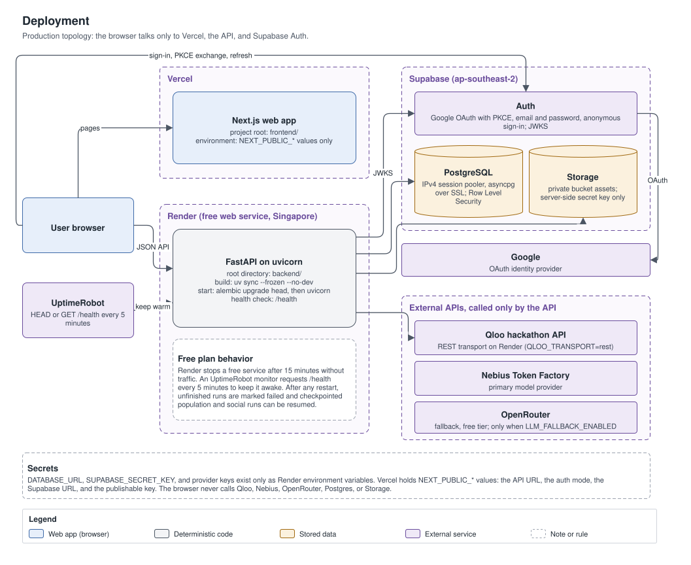

| Component | Host | Notes |
|---|---|---|
| Web app | Vercel, https://nativeproof.vercel.app | Next.js project with root directory `frontend/` |
| API | Render free web service in Singapore, https://nativeproof-api.onrender.com | Defined in [`render.yaml`](render.yaml) |
| Database, Auth, Storage | Supabase project in `ap-southeast-2` | The API reaches PostgreSQL through the IPv4 session pooler |
| Uptime monitor | UptimeRobot | Requests `/health` every 5 minutes so the free instance stays awake; `/health` answers GET and HEAD |

**Supabase**

1. Create a project and note its URL, publishable key, and secret key.
2. In Authentication, enable email sign-in, anonymous sign-ins, and the Google provider. For Google, create an OAuth client in Google Cloud whose authorized redirect URI is `https://<project-ref>.supabase.co/auth/v1/callback`, and paste its client id and secret into Supabase.
3. Set the Site URL to the web app origin and add `https://<web-app-origin>/auth/callback` (and `http://localhost:3000/auth/callback` for local development) to the redirect URLs.
4. Use the session pooler connection string as `DATABASE_URL` in the `postgresql+asyncpg://...?ssl=require` form. Migrations create the tables, policies, and the `assets` bucket.

**Render**

1. Create a Blueprint from `render.yaml`: a free Python web service with root directory `backend/`, build `pip install uv && uv sync --frozen --no-dev`, start `uv run --no-sync alembic upgrade head && uv run --no-sync uvicorn app.main:app --host 0.0.0.0 --port $PORT --timeout-graceful-shutdown 10`, and health check `/health`. Free instances have no pre-deploy step, so migrations run at start.
2. Fill in the variables marked `sync: false` in the dashboard: `FRONTEND_ORIGINS` (the Vercel origin), `SUPABASE_URL`, `DATABASE_URL`, `SUPABASE_SECRET_KEY`, the Nebius, OpenRouter, and Qloo settings, and the embedding and vision settings. The blueprint fixes `APP_ENV=production`, `AUTH_MODE=supabase`, `ASSET_STORAGE_BACKEND=supabase`, and `QLOO_TRANSPORT=rest`.

**Vercel**

1. Import the repository with `frontend/` as the root directory.
2. Set `NEXT_PUBLIC_API_BASE_URL` to the API origin, `NEXT_PUBLIC_AUTH_MODE=supabase`, `NEXT_PUBLIC_SUPABASE_URL`, and `NEXT_PUBLIC_SUPABASE_PUBLISHABLE_KEY`. Leave `NEXT_PUBLIC_API_MOCK` unset.

**Monitoring**

Point an HTTP monitor at `https://<api-origin>/health`. `/ready` gives a fuller picture: database, provider, and capability status.

## Tests

The default backend test run is hermetic: SQLite, fake providers, and fixtures, with no paid API call.

```bash
# API: unit, API, integration, contract, and security suites
cd backend
uv run pytest -q

# Contract: regenerate the OpenAPI document and check that it did not change
uv run python -m scripts.export_openapi
git diff --exit-code ../contracts/openapi.json

# Opt-in: migrations and Row Level Security on a disposable PostgreSQL server (never Supabase)
TEST_POSTGRES_URL=postgresql+asyncpg://postgres@127.0.0.1:55432/postgres uv run pytest -q -m postgres

# Opt-in: live Qloo and provider checks (reads credentials from the environment or backend/.env)
NATIVEPROOF_LIVE_TESTS=1 uv run pytest -q tests/integration/test_live_qloo.py

# Opt-in: real Supabase auth (SUPABASE_URL, a publishable key, and a cleanup credential in the environment)
uv run pytest -q -m live_supabase tests/security/test_live_supabase.py

# Web app
cd ../frontend
npm run typecheck
npm run lint
npm run build

# End to end: Playwright against a running web app and API (they are not started by the tests)
cd ../e2e
npm ci
npx playwright install chromium
E2E_BASE_URL=http://localhost:3000 E2E_API_URL=http://localhost:8000 npx playwright test
```

**Results for the published release**

| Check | Result |
|---|---|
| Backend suite (`uv run pytest -q`, SQLite) | 489 passed, 8 skipped (opt-in live and Postgres tests) |
| GitHub Actions on `main` | backend, postgres (Alembic sequence, data safety, RLS, API and security suites on PostgreSQL 17), frontend (typecheck, lint, build) and gitleaks: all passing |
| Frontend `typecheck`, `lint`, `build` | passing |
| Live smoke test against production (anonymous session) | discovery, 20-participant study, 1-round social simulation, participant and group follow-ups: all passing |

## Scope and limitations

These describe what the method can and cannot establish, and the conditions of this deployment, so that results are read correctly.

- **Synthetic participants are not real people.** Interviews, reactions, follow-up answers, and social posts are generated by a model. They are useful for finding questions, not for answering them; validate decisions with real people.
- **One model voices everyone.** Synthetic participants share one model's biases, so agreement between them is not independent confirmation, and statistics over generated responses describe the simulation, not the market.
- **Model interpretations are labeled, not verified.** Briefs, interpretations, risk assessments, and influence paths are model text. Code checks their citations and excerpts, but not whether the reasoning is right.
- **Affinity is not demand.** Qloo affinity data describes cultural associations in aggregate. It does not establish purchase intent, causality, or campaign success, and the confidence labels are not calibrated probabilities.
- **Qloo data conditions.** Live research uses the hackathon credential, its host, and its quotas. Results are bounded and cached, can change between retrievals, and are not published in this repository. When a term matches several candidates, a person chooses one (in Atlas and Market Expansion); a term with no match is reported as a gap.
- **Hosting.** The API runs on Render's free tier with an uptime monitor, and the first request after an idle period can take about a minute. Runs execute inside the API process: population studies and social simulations save checkpoints and resume after a restart, and other runs report the interruption and can be started again.
- **Demo mode uses labeled fixtures.** Demo projects cover one fictional scenario in one market and decline anything the fixtures do not describe.
- **Model-dependent features.** Search, Brand Memory example selection, and vision use configured models. Where a model is not configured, they report `unavailable` instead of substituting another method. The OpenRouter fallback is off by default and uses free-tier models.
- **Trend Watch compares snapshots.** It needs two saved discovery runs for the same market.

## Repository layout

```text
backend/               FastAPI service (uv project): app/, migrations/, scripts/, tests/, qloo/ (pinned harness)
frontend/              Next.js web app: src/app (routes), src/features (feature modules), src/components, src/lib
contracts/             openapi.json (generated) and fixtures/ (one labeled demo journey)
e2e/                   Playwright end-to-end tests
diagrams/         src/ (draw.io sources), svg/ and png/ (exports)
scripts/               export-diagrams.ps1 re-exports every diagram with the draw.io CLI
render.yaml            Render blueprint for the API
```

To change a diagram, edit its source in `diagrams/src/` with draw.io and run `powershell -ExecutionPolicy Bypass -File scripts/export-diagrams.ps1`.

## Acknowledgments

- Cultural affinity data comes from [Qloo](https://www.qloo.com/) through the official hackathon kit.
- Map shapes come from world-atlas (Natural Earth, public domain).
